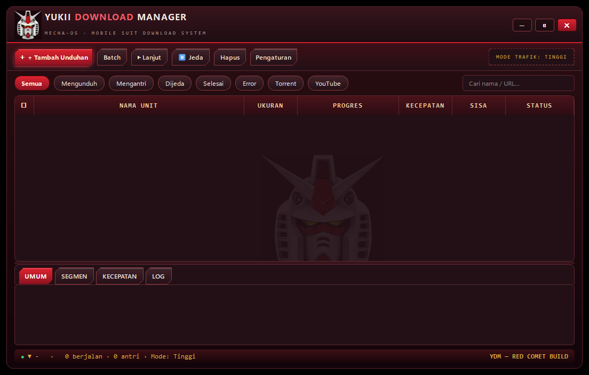

# Yukii Download Manager (YDM)

**Aplikasi download manager untuk Windows** — unduh file lebih cepat (multi-segmen), bisa di-jeda & dilanjutkan kapan saja, download video YouTube, torrent, dan kirim unduhan langsung dari browser. Tampilannya bertema Gundam *Red Comet* dan bisa berbahasa **Indonesia / English**.



---

## Daftar Isi
- [Fitur Utama](#fitur-utama)
- [Cara Menjalankan (pilih salah satu)](#cara-menjalankan)
  - [Cara 1 — File .exe portable (paling mudah, tanpa install)](#cara-1--file-exe-portable)
  - [Cara 2 — Dari kode sumber (Python)](#cara-2--dari-kode-sumber-python)
- [Cara Menggunakan](#cara-menggunakan)
- [Ekstensi Browser (Chrome / Edge / Firefox)](#ekstensi-browser)
- [Pengaturan yang Berguna](#pengaturan-yang-berguna)
- [Tanya Jawab](#tanya-jawab)
- [Catatan](#catatan)

---

## Fitur Utama

- ⚡ **Unduhan multi-segmen** — satu file dipecah jadi banyak bagian dan diunduh bersamaan, jadi lebih cepat; kalau koneksi putus atau aplikasi ditutup, unduhan **bisa dilanjutkan** dari titik terakhir, bukan dari nol.
- ⏯️ **Jeda & Lanjut** kapan saja, plus **penjadwalan** (misalnya mulai 1 jam lagi).
- 🎬 **Download video YouTube** — tempel tautan YouTube, pilih kualitas (1080p / 720p / 480p / 360p / Terbaik / MP3). Mesin pengunduhnya (yt-dlp) **ter-update otomatis**, jadi tetap bekerja saat YouTube mengubah sistemnya.
- 🧲 **Torrent & magnet link**, termasuk membuka file `.torrent`.
- 🌐 **Ekstensi browser** — klik tombol unduh di browser, file langsung masuk ke YDM. Di YouTube ada tombol khusus "Unduh dengan YDM".
- ✅ **Popup konfirmasi** sebelum unduhan dimulai (bisa dimatikan di Pengaturan).
- ☑️ **Pilih banyak sekaligus** — centang beberapa unduhan, lalu Jeda/Lanjut/Hapus bersamaan.
- 📂 **Folder rapi otomatis** — hasil unduhan bisa diurutkan ke subfolder per kategori (Video, Musik, Dokumen, dll).
- 🚦 **Batas kecepatan** global & per-file, dengan mode trafik Rendah / Sedang / Tinggi.
- 🔀 **Konversi media** ke MP3/MP4 (memakai ffmpeg, sudah termasuk di versi .exe).
- 🖥️ **Tema mengikuti Windows** (terang/gelap) atau pilih manual, bahasa **Indonesia / English** yang langsung berubah tanpa mulai ulang.
- 🔔 Ikon di **system tray**, pantau clipboard (tautan yang disalin otomatis ditawarkan untuk diunduh), dan bisa **jalan otomatis saat Windows mulai**.

---

## Cara Menjalankan

### Cara 1 — File .exe portable

Cara termudah, **tidak perlu install apa pun** (tidak perlu Python).

1. Unduh **`YDM-Portable.zip`** dari halaman **Releases** repo ini.
2. **Ekstrak** zip-nya ke folder mana saja, misalnya `D:\YDM`.
3. Buka folder hasil ekstrak, lalu klik dua kali **`YDM.exe`**.
4. Selesai — aplikasi langsung terbuka.

> **Muncul peringatan biru Windows ("Windows protected your PC")?**
> Itu SmartScreen, muncul karena aplikasi ini belum memiliki sertifikat digital berbayar — bukan virus. Klik **More info** → **Run anyway** untuk tetap menjalankan.

Kebutuhan: **Windows 10 / 11 (64-bit)**.

### Cara 2 — Dari kode sumber (Python)

Untuk yang ingin menjalankan dari source code:

1. Install **Python 3.11 atau lebih baru** dari [python.org](https://www.python.org/downloads/) — saat install, centang **"Add python.exe to PATH"**.
2. Unduh repo ini (tombol **Code → Download ZIP**) lalu ekstrak, atau clone:
   ```bash
   git clone https://github.com/Yukii-id/Yukii-Download-Manager.git
   cd Yukii-Download-Manager
   ```
3. Install dependensi:
   ```bash
   pip install -r requirements.txt
   pip install -r requirements-optional.txt   # opsional: dukungan torrent (libtorrent)
   ```
4. Jalankan dengan klik dua kali **`Jalankan-YDM.bat`**, atau dari terminal:
   ```bash
   python app.py
   ```
5. (Opsional) Untuk fitur konversi media & penggabungan video YouTube, install **ffmpeg** dan pastikan masuk PATH. Di versi .exe, ffmpeg **sudah termasuk**.

---

## Cara Menggunakan

**Menambah unduhan** — ada 3 cara:
1. Klik **+ Tambah Unduhan**, tempel tautan (URL / magnet / link YouTube), atur folder & nama file bila perlu, klik OK.
2. **Seret & letakkan** (drag & drop) tautan atau file `.torrent` ke jendela YDM.
3. Dari **browser** lewat ekstensi (lihat bagian berikutnya).

Setelah itu muncul **popup konfirmasi** — klik **Ya, Download** untuk mulai.

**Mengatur unduhan yang sedang berjalan:**
- **Jeda / Lanjut** — klik barisnya, lalu pakai tombol di atas, atau **klik kanan** pada baris.
- **Pilih banyak** — centang kotak di kolom paling kiri (klik kotak di header untuk memilih semua), lalu Jeda/Lanjut/Hapus bersamaan.
- **Jadwalkan** — klik kanan → *Jadwalkan 1 jam lagi*.
- **Unduhan banyak sekaligus** — tombol **Batch**, tempel banyak tautan (satu per baris, maks 100).
- **Panel bawah** — tab **Umum** (detail file), **Segmen** (peta potongan unduhan), **Kecepatan** (grafik), **Log** (catatan proses).

Menutup jendela akan menyembunyikan YDM ke **system tray** (dekat jam Windows) — unduhan tetap berjalan. Untuk keluar sepenuhnya: klik kanan ikon tray → **Keluar**.

---

## Ekstensi Browser

Dengan ekstensi, tautan unduhan di browser bisa dikirim ke YDM dalam sekali klik, dan di YouTube muncul tombol **"Unduh dengan YDM"** lengkap dengan pilihan kualitas.

**Chrome / Edge:**
1. Buka `chrome://extensions` (Edge: `edge://extensions`).
2. Aktifkan **Developer mode** (pojok kanan atas).
3. Klik **Load unpacked**, pilih folder **`extension/chromium`** dari folder aplikasi/repo ini.
4. Ekstensi muncul dan punya **ID** (32 huruf acak) — catat ID itu.
5. Jalankan file penghubungnya satu kali:
   - Versi .exe: **`Install-Ekstensi-Browser-Exe.bat`**
   - Versi source: **`Install-Ekstensi-Browser.bat`**
   
   lalu masukkan ID ekstensi saat diminta.
6. Muat ulang (reload) ekstensi di `chrome://extensions`. Selesai!

**Firefox:** buka `about:debugging` → *This Firefox* → *Load Temporary Add-on* → pilih `extension/firefox/manifest.json`, lalu jalankan file penghubung yang sama seperti di atas.

---

## Pengaturan yang Berguna

Buka lewat tombol **Pengaturan**:

| Pengaturan | Fungsi |
|---|---|
| Folder unduhan | Tempat menyimpan hasil unduhan — klik **Pilih...** untuk memilih folder |
| Bahasa / Language | Indonesia / English, **langsung berubah** tanpa mulai ulang |
| Startup Windows | YDM jalan otomatis setiap komputer dinyalakan |
| Popup konfirmasi | Matikan bila tidak ingin ditanya sebelum setiap unduhan |
| Tema | Sistem (ikuti Windows) / Terang / Gelap |
| Mode trafik | Batas kecepatan global: Rendah / Sedang / Tinggi |
| Unduhan bersamaan maks | Berapa file boleh diunduh dalam waktu yang sama |
| Kualitas YouTube bawaan | Kualitas video yang dipilih otomatis untuk link YouTube |
| Cookies YouTube dari browser | Diperlukan hanya untuk video yang dibatasi usia / privat |

---

## Tanya Jawab

**Unduhan berhenti di tengah jalan, harus mengulang dari nol?**
Tidak. Klik barisnya lalu **Lanjut** — YDM melanjutkan dari potongan yang sudah terunduh (file sementara berakhiran `.seg` di folder tujuan; jangan dihapus selama unduhan belum selesai).

**Kok muncul peringatan SmartScreen / antivirus?**
Aplikasi .exe dibuat dengan PyInstaller dan belum ditandatangani sertifikat digital, jadi Windows wajar berhati-hati. Pilih **More info → Run anyway**. Bila ragu, jalankan **Cara 2 (source code)** — semua kode terbuka dan bisa diperiksa.

**Video YouTube gagal diunduh?**
Pastikan aplikasi versi terbaru (yt-dlp di dalamnya ter-update otomatis). Untuk video dibatasi usia, isi **Cookies YouTube dari browser** di Pengaturan (mis. `chrome`) sambil browser dalam keadaan sudah login YouTube.

**Apakah data saya dikirim ke server?**
Tidak. Semua data (daftar unduhan & pengaturan) tersimpan **lokal** di folder `data` di samping aplikasi. Ada fitur *remote control* lokal yang **mati secara bawaan** dan hanya menerima koneksi dari komputer yang sama (127.0.0.1) bila diaktifkan.

**Bisa dipakai di Mac / Linux?**
Versi .exe hanya untuk Windows. Source code-nya berbasis Python + PySide6 sehingga *secara teori* bisa jalan di OS lain, tapi belum diuji resmi.

---

## Catatan

- Aplikasi ini dibuat untuk penggunaan pribadi. Hormati hak cipta dan ketentuan layanan dari konten yang Anda unduh.
- Logo Gundam pada tema adalah karya penggemar (fan art) untuk pemakaian pribadi, bukan aset resmi Bandai/Sunrise.
